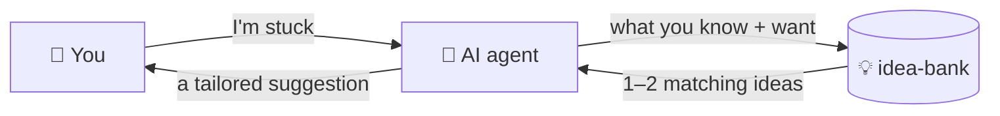

<p align="center">
  
</p>

<p align="center">
  <a href="https://www.npmjs.com/package/idea-bank"></a>
  
  
  <a href="./LICENSE"></a>
</p>

<h3 align="center">Out of ideas? Don't scroll lists of "100 project ideas".<br>Ask your AI agent, and get <em>one</em> idea that actually fits you.</h3>

---

## ✨ Why idea-bank

|  |  |
|---|---|
| 🎯 **Fits you, not everyone** | Tell it what you know and how much time you have. You get 1–2 matching ideas, not a wall of text. |
| 🔒 **A curated, locked bank** | Hand-picked project briefs, each with difficulty and *what you'll learn*. Never dumped all at once. |
| 💬 **Conversation first** | The agent talks with you first, then suggests. The best idea comes from the dialog. |
| 🧭 **Spots your blind spots** | Run it locally and it scans your own projects for domains and tech you've never touched. |

---

## 🚀 Get started in 30 seconds

Pick one:

### ① claude.ai: no install

1. Open **Settings → Connectors → Add custom connector**
2. Paste:

   ```
   https://mcp.laferrari.eu/mcp
   ```

3. Done. Start a new chat.

### ② Claude Code

```bash
claude mcp add idea-bank -- npx -y idea-bank
```

Restart Claude Code and the tools load on startup.

### ③ Claude Desktop / any MCP client

```json
{
  "mcpServers": {
    "idea-bank": { "command": "npx", "args": ["-y", "idea-bank"] }
  }
}
```

> **Hosted vs. local:** the hosted URL only *recommends* ideas from the curated bank.
> The local version (② / ③) also keeps **your own private bank** and analyzes **your own projects**.

---

## 💬 See it in action

You never call tools by hand. Just talk:

> 🧑 **You:** I'm out of ideas, I want to build something this weekend.
>
> 🤖 **Claude:** Happy to help! What do you already know, and what are you curious about?
>
> 🧑 **You:** Bash and Docker. I'd like to see what my server is doing.
>
> 🤖 **Claude:** *(asks idea-bank)* Two ideas that fit a weekend:
>
> 1. **Prometheus + node_exporter + alerts to Telegram** · level 3
>    *You'll learn:* metrics, PromQL, alert rules
> 2. **Custom systemd service with auto-restart & logs** · level 2
>    *You'll learn:* unit files, journald, process management
>
> The first one sounds like what you're after. Want me to sketch a plan for Saturday and Sunday?

**More things to say:**

| Say… | You get |
|---|---|
| *"Something easy, about one evening."* | beginner ideas (level 1) |
| *"I want to try Rust."* | ideas matched to the tech |
| *"What categories do you have?"* | the bank's topics |
| *"What's missing in my portfolio?"* 🏠 | gaps in your own projects |
| *"Save that to the bank."* 🏠 | the idea goes into your private bank |

🏠 = local version only

---

## 🧠 How it works



The bank never hands out a finished list. **The value is in the conversation**, so you
come back next time you're stuck.

**Difficulty levels:** 1 · an evening &nbsp;|&nbsp; 2 · a weekend &nbsp;|&nbsp; 3 · a week+ &nbsp;|&nbsp; 4 · a month

---

## 📚 More

- [Technical reference](docs/REFERENCE.md): every tool, configuration, privacy & self-hosting
- [Česká dokumentace](docs/README.cs.md)

## License

[MIT](./LICENSE) · made with ☕ at [laferrari.eu](https://laferrari.eu)
